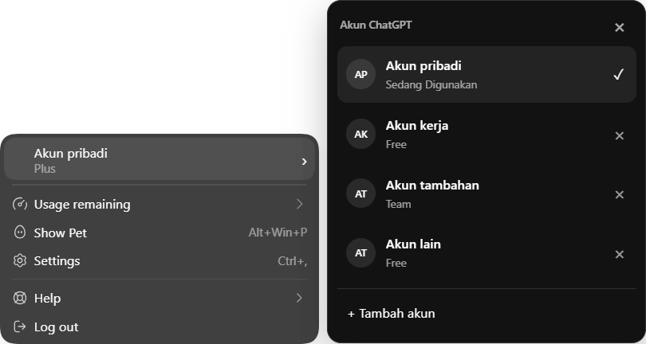
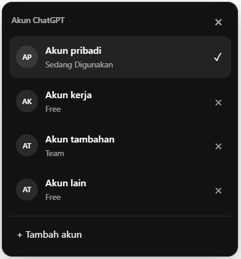
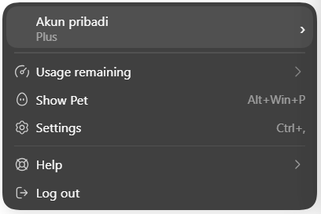

# Desktop screenshots

These captures show Codex Account Deck running in an isolated Windows Codex profile on 28 October 2026, package 26.1023.6123.0 / desktop 26.1023.50603.

Account names and avatar initials were temporarily replaced with generic labels in the rendered page. The underlying project/chat area was hidden during capture to avoid exposing private names through the translucent native menu. Saved credentials and account metadata were not modified. These are captures of the running UI, not generated mockups.

## Profile menu and account list

Hover over or select the account-name row to open the saved account list. There is no additional switch-account menu item. The check mark identifies the active account.

## Account list

Choosing a different account displays progress and closes the list after successful backend verification. A static screenshot does not establish animation frame timing; see the desktop validation report for the tested behavior.

## Native profile menu

